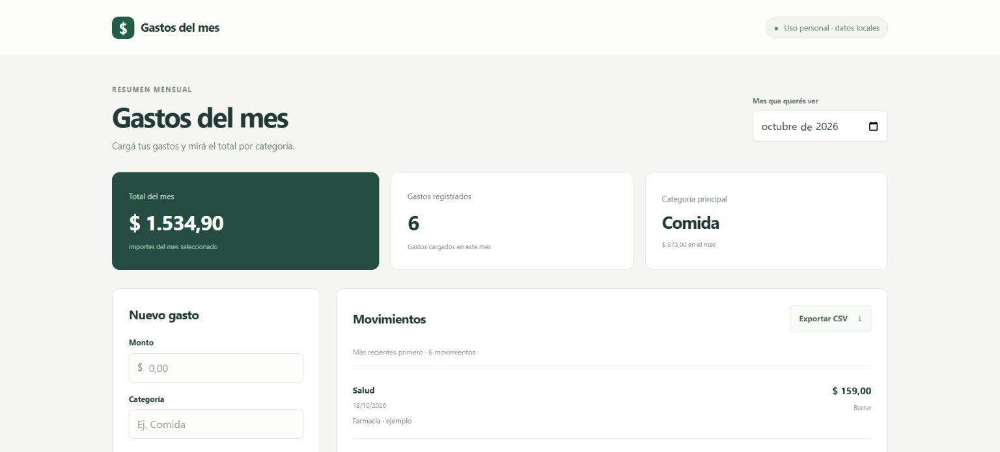

# Gastos del mes

[](https://github.com/juliomarianocampuzano-git/gastos-del-mes/actions/workflows/ci.yml)

Una app para cargar gastos del hogar, ver el total del mes por categoría y descargar los movimientos en CSV. Guarda los datos en una base SQLite en tu computadora.



## Qué hace

- Agregar y eliminar gastos, con confirmación antes de eliminar.
- Filtrar movimientos por mes y ver totales y distribución por categoría.
- Exportar el mes seleccionado a CSV con importes exactos y caracteres en español.
- Probar una demo local con seis movimientos ficticios.
- Conservar gastos en SQLite al reiniciar la aplicación.

Los cálculos y el almacenamiento usan **centavos enteros**. El símbolo $ representa una única moneda elegida por quien usa la aplicación; no hay conversión de divisas.

## Instalación y uso

Requiere Python 3.11 o posterior.

### Windows (PowerShell)

```powershell
python -m venv .venv
.\.venv\Scripts\python.exe -m pip install -r requirements.txt
.\.venv\Scripts\python.exe app.py
```

### Linux / macOS

```bash
python3 -m venv .venv
.venv/bin/python -m pip install -r requirements.txt
.venv/bin/python app.py
```

Abrí **http://127.0.0.1:5000**. El comando de inicio escucha únicamente en localhost y no activa el depurador. La base se crea automáticamente en `data/gastos.db`.

## Demo reproducible

Usá una base separada para evitar mezclar ejemplos con gastos personales. La carga de demo requiere una base vacía y se rechaza si ya contiene movimientos.

### Windows

```powershell
$env:GASTOS_DATABASE = "$PWD/data/demo.db"
.\.venv\Scripts\python.exe -m flask --app app:create_app seed-demo --month 2026-10
.\.venv\Scripts\python.exe app.py
```

### Linux / macOS

```bash
export GASTOS_DATABASE="$PWD/data/demo.db"
.venv/bin/python -m flask --app app:create_app seed-demo --month 2026-10
.venv/bin/python app.py
```

Elegí **octubre de 2026** en el selector: aparecen **6 gastos**, un total de **1534.90**, y **Comida** como categoría principal, con **673.00**. Podés omitir `--month` para usar el mes actual.

Para volver a la base habitual, detené la aplicación y quitá la variable de entorno (`Remove-Item Env:GASTOS_DATABASE` en PowerShell; `unset GASTOS_DATABASE` en Bash).

## Validación y precisión

- Montos positivos, finitos, de hasta dos decimales y un máximo de 999999999.99.
- Fechas reales de calendario en formato AAAA-MM-DD; meses con formato AAAA-MM.
- Categorías de 1 a 60 caracteres y notas de hasta 500.
- El texto ingresado se presenta con nodos de texto; no se interpreta como HTML.
- El CSV usa UTF-8 con BOM, separador coma y punto decimal. Protege los textos que podrían interpretarse como fórmulas al abrirlos en una planilla, agregando un apóstrofo. Según la configuración regional de Excel, puede ser necesario importar el archivo indicando esos separadores.

## Bases de la versión anterior

Al abrir una base con la columna anterior `amount REAL`, la aplicación:

1. Crea un respaldo SQLite junto al archivo, con nombre `gastos.db.pre-cents-FECHA.bak`.
2. Convierte los importes a centavos en una transacción, preservando IDs y movimientos. Los importes antiguos con más de dos decimales se redondean con la regla HALF_UP.
3. Cancela la conversión si encuentra importes inválidos y conserva la tabla original.

Detené cualquier instancia anterior antes de abrir la misma base. Los respaldos contienen información personal igual que la base: se excluyen de Git. Para recuperar uno, detené la aplicación, conservá una copia del archivo actual y restaurá el respaldo en la ruta configurada.

## Desarrollo y tests

```bash
python -m pip install -r requirements-dev.txt
python -m pytest -q
python -m ruff check .
python -m ruff format --check .
node --check static/app.js
```

Los tests usan bases temporales; no dependen de Internet ni de gastos reales. Cubren importes, validación, filtros mensuales, exportación, aislamiento entre instancias, persistencia, migración y carga segura de demo.

GitHub Actions ejecuta estas verificaciones en Linux (Python 3.11 y 3.14) y Windows (Python 3.12). Node.js solo se necesita para verificar la sintaxis del JavaScript durante desarrollo; la aplicación no necesita Node para funcionar.

## API

| Método | Ruta                               | Resultado                    |
| ------ | ---------------------------------- | ---------------------------- |
| GET    | /api/expenses?month=2026-10        | Movimientos del mes          |
| GET    | /api/summary?month=2026-10         | Total, cantidad y categorías |
| POST   | /api/expenses                      | Crear un gasto               |
| DELETE | /api/expenses/1                    | Eliminar por ID              |
| GET    | /api/expenses/export?month=2026-10 | Descargar CSV                |

Ejemplo de cuerpo JSON:

```json
{
  "amount": "12.50",
  "category": "Comida",
  "note": "Ejemplo ficticio",
  "spent_on": "2026-10-03"
}
```

La respuesta expone `amount_cents` como importe de referencia. Se conservan `amount` y `total` en unidades monetarias para compatibilidad con clientes anteriores. Los errores de validación devuelven HTTP 400 con un campo `error`; un ID inexistente devuelve 404.

## Estructura

- `app.py`: fábrica de aplicaciones, API, SQLite, migración y comando de demo.
- `templates/` y `static/`: interfaz sin frameworks ni fuentes remotas.
- `tests/`: verificaciones del comportamiento.
- `docs/demo.jpg`: captura de los datos ficticios.
- `data/`: bases locales y respaldos; no se versiona.

## Alcance

Pensada para uso personal local. No tiene usuarios, autenticación, sincronización bancaria, presupuestos ni reparto entre personas. No es un sistema contable ni una aplicación preparada para exponerse directamente a Internet. El reparto de gastos queda como una idea futura del plan de consolidación.

## Licencia

MIT. Ver [LICENSE](LICENSE).
